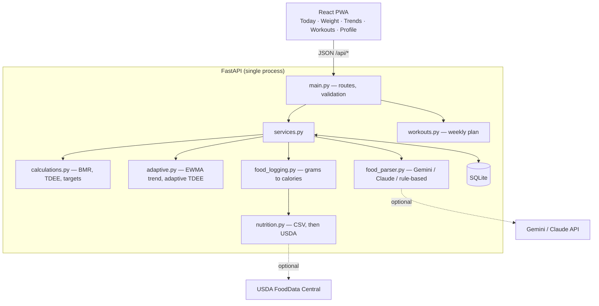

# Adaptive Nutrition Coach

A self-hosted progressive web app that sets calorie and macro targets for cutting, maintaining, or bulking, then re-estimates the user's actual energy expenditure each week from logged intake and the weight trend.

Food is logged in plain English ("2 eggs and toast"); an LLM converts the text into structured items, and nutrition values come from a bundled food table or USDA FoodData Central. The app also generates a weekly workout plan from the user's goal, schedule, and available equipment.

## Features

- **Starting targets** from the Mifflin-St Jeor BMR equation and an activity multiplier, with safety limits on loss/gain rate and a calorie floor.
- **Adaptive TDEE**: smooths daily weigh-ins into a trend, compares it with logged intake, and updates targets at a weekly check-in.
- **Natural-language food logging** via Google Gemini (default), Claude, or an offline rule-based parser. Nutrition comes from a bundled CSV or USDA FoodData Central.
- **Weekly workout plan** for 2–6 training days per week and full gym, dumbbell, or bodyweight equipment.
- **Charts** for raw and trend weight and for daily intake against target.
- **Installable PWA** with an offline app shell and light and dark themes.

## Architecture



External services are optional. Without API keys the app uses the rule-based parser and the bundled food table (47 foods). In production, FastAPI also serves the built frontend, so a single `uvicorn` process runs the whole app.

The calculation modules (`calculations.py`, `adaptive.py`, `workouts.py`) are pure functions with no database or web dependencies. The parser, nutrition source, database session, and current date are FastAPI dependencies, so tests replace them with offline fakes.

### Tech stack

| Component | Role |
|---|---|
| FastAPI, Pydantic | HTTP API and request validation; OpenAPI docs at `/docs` |
| SQLAlchemy, SQLite | Single-file persistence with no external database |
| Google Gen AI SDK (`gemini-3.5-flash-lite`) | Default food parser, constrained by a JSON response schema |
| Anthropic SDK (`claude-haiku-4-5`) | Alternative parser using structured outputs (`LLM_PROVIDER=claude`) |
| httpx | USDA client; `MockTransport` enables offline tests |
| React, Vite, Recharts | Frontend, build tooling, and charts |
| vite-plugin-pwa | Web app manifest and service worker |
| pytest | 123 tests covering the math, parsing, planner, and API |

## Method

### BMR and TDEE

```
BMR  = 10 × weight(kg) + 6.25 × height(cm) − 5 × age(years) + s
       s = +5 (male), −161 (female)
TDEE = BMR × activity factor
```

| Activity level | Multiplier |
|---|---|
| Sedentary | 1.2 |
| Light (1–3 days/week) | 1.375 |
| Moderate (3–5 days/week) | 1.55 |
| Active (6–7 days/week) | 1.725 |
| Very active | 1.9 |

Example: 80 kg, 180 cm, 30-year-old male → BMR 1780 kcal/day; at a moderate activity level, TDEE ≈ 2759 kcal/day.

### Calorie target

Rates are a percentage of body weight per week (defaults: cut 0.5%, bulk 0.25%), using 7700 kcal per kg of body-weight change:

```
kg per week     = weight × rate% / 100
daily change    = kg per week × 7700 / 7
target calories = TDEE − daily change   (cut)
                = TDEE + daily change   (bulk)
                = TDEE                  (maintain)
```

Example: a 0.5% cut at 80 kg is 0.4 kg/week, a 440 kcal/day deficit, giving a target of 2319 kcal.

Safety limits, each of which returns a warning:

- Loss rate capped at 1%/week; gain rate capped at 0.5%/week.
- Calories never below 1500 (male) / 1200 (female). When the floor applies, the achievable rate is recalculated.
- If protein and fat minimums do not fit within the target, carbohydrates are set to 0.

### Macros

```
protein = 2.2 g/kg (cut) or 1.8 g/kg (maintain/bulk)
fat     = max(25% of calories ÷ 9, 0.6 g/kg)
carbs   = (calories − protein×4 − fat×9) ÷ 4
```

### Weight trend (EWMA)

Daily weight varies by 1–2 kg from water and sodium. The trend is an exponentially weighted moving average:

```
trend_today = trend_yesterday + α × (weight_today − trend_yesterday),   α = 0.1
```

When days are skipped, the next weigh-in is weighted as `α_eff = 1 − (1 − α)^days_since_last`.

### Adaptive TDEE

By energy balance:

```
TDEE_estimate = mean daily intake − (trend slope in kg/day × 7700)
```

The slope is a least-squares fit over the trend for the last 28 days. Example: a 2000 kcal average intake with a trend falling 0.039 kg/day gives an estimate of about 2300 kcal/day.

Guard rails:

- Requires at least 10 food-logged days and 7 weigh-ins spanning 14 days; otherwise the current value is kept.
- Confidence = logged days ÷ 21 (capped at 1). `TDEE = confidence × estimate + (1 − confidence) × formula`.
- Estimates outside ±30% of the formula value are clamped (typically a sign of incomplete logging).
- The TDEE used for targets changes by at most ±200 kcal per weekly check-in.

## Quickstart

Requires Python 3.12, Node 20+, and conda.

```bash
conda create -n adaptive-nutrition-coach python=3.12 -y
conda activate adaptive-nutrition-coach
pip install -r requirements.txt

cd frontend && npm install && npm run build && cd ..

cp .env.example .env    # optional: add API keys
```

All API keys are optional. `LLM_PROVIDER` selects the food parser: `gemini` (default, requires `GEMINI_API_KEY`), `claude` (requires `ANTHROPIC_API_KEY`), or `fake`. If the selected provider has no key, the offline rule-based parser is used. Without `USDA_API_KEY`, only the bundled food table is used.

Run the app (FastAPI serves the built frontend):

```bash
uvicorn app.main:app --app-dir backend --port 8000
```

Open http://localhost:8000. The app can be installed from the browser ("Install app" in Chrome/Edge, or Share → Add to Home Screen in iOS Safari). Installation on a phone requires HTTPS unless served from `localhost`.

Load six weeks of simulated weigh-ins and meals (replaces existing data):

```bash
python scripts/seed_demo.py
```

Development mode with hot reload, in two terminals:

```bash
uvicorn app.main:app --app-dir backend --reload --port 8000
```

```bash
cd frontend && npm run dev
```

The dev frontend runs at http://localhost:5173 and proxies `/api` to FastAPI.

## Running tests

The test suite runs offline; no API keys or network access are required.

```bash
pytest backend
```

| File | Coverage |
|---|---|
| `test_calculations.py` | BMR, TDEE, targets, safety limits, macros |
| `test_adaptive.py` | EWMA, slope, adaptive TDEE convergence and edge cases, using simulated users with a known true TDEE |
| `test_food.py` | Parsers, CSV and mocked USDA lookups, gram resolution, fake Gemini/Claude clients, provider selection |
| `test_workouts.py` | Planner splits, equipment variants, determinism |
| `test_api.py` | End-to-end API flows, including a five-week check-in simulation |

## Project structure

```
adaptive-nutrition-coach/
├── DECISIONS.md               Design decision log
├── requirements.txt           Pinned Python dependencies
├── .env.example               API key template (placeholders only)
├── backend/
│   ├── pytest.ini
│   ├── data/foods.csv         Bundled nutrition table (per 100 g, with unit weights)
│   ├── app/
│   │   ├── calculations.py    BMR, TDEE, calorie targets, safety caps, macro split
│   │   ├── adaptive.py        EWMA weight trend and adaptive TDEE estimate
│   │   ├── workouts.py        Rule-based weekly workout planner
│   │   ├── food_parser.py     Gemini, Claude, and rule-based parsers (shared interface)
│   │   ├── nutrition.py       Food lookup: bundled CSV, then USDA FoodData Central
│   │   ├── food_logging.py    Gram resolution and calorie/macro calculation
│   │   ├── db.py              SQLite tables: profile, weights, food entries, check-ins
│   │   ├── services.py        Orchestration between the database and calculations
│   │   └── main.py            FastAPI routes under /api; serves the built frontend
│   └── tests/
│       ├── conftest.py        In-memory database and offline parser fixtures
│       └── test_*.py          See "Running tests"
├── frontend/
│   ├── index.html             HTML shell with PWA meta tags
│   ├── vite.config.js         Vite and PWA plugin config; dev proxy to FastAPI
│   ├── package.json
│   ├── public/                Favicon and PWA icons
│   └── src/
│       ├── main.jsx           React entry point
│       ├── App.jsx            Tab navigation, onboarding, automatic weekly check-in
│       ├── api.js             Fetch wrapper for backend endpoints
│       ├── index.css          Design tokens (light/dark) and styles
│       └── components/
│           ├── Today.jsx      Targets, macro progress, food log
│           ├── WeightView.jsx Weigh-in form, weight and trend chart, history
│           ├── Trends.jsx     30-day intake vs target, check-in history
│           ├── Plan.jsx       Weekly workout plan
│           └── ProfileForm.jsx Body stats, goal, training settings
└── scripts/
    ├── seed_demo.py           Generates six weeks of simulated data
    └── make_icons.py          Generates PNG app icons (standard library only)
```

## Design decisions

See [DECISIONS.md](DECISIONS.md) for the full log. Highlights:

- **The LLM extracts foods and quantities only.** Nutrition values always come from the food table or USDA, so the model cannot invent calorie numbers.
- **One parser interface, three implementations.** Gemini, Claude, and the rule-based parser expose the same `parse(text)` method; switching providers is a single `.env` change, and LLM failures fall back to the rule-based parser.
- **Smoothing and damping over raw measurements.** EWMA filtering, a least-squares slope, confidence blending, and the ±200 kcal weekly cap trade responsiveness for stability.
- **Unlogged days are skipped, not counted as zero intake.**

## Limitations and future work

- Single user with no authentication; metric units only.
- Assumes logged days are complete.
- Protein targets use total body weight, which overstates requirements at high body-fat levels.
- The EWMA trend lags real weight change during the first weeks of use.
- No database migrations and no frontend tests.
- Not medical advice. Consult a professional before aggressive dieting, particularly with existing health conditions.
